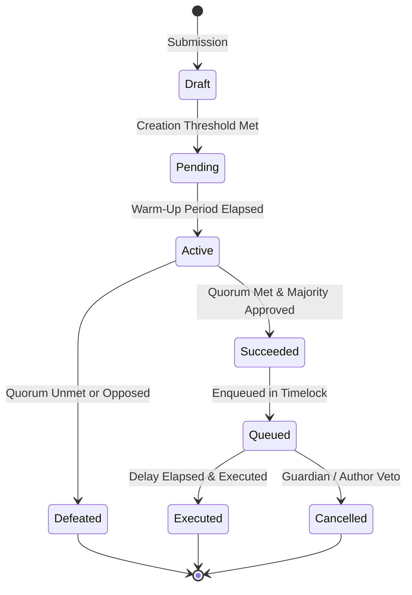

# Governance Best Practices for Soroban Smart Contracts

This document provides architectural patterns, security guidelines, and real-world implementation standards for designing robust, tamper-resistant on-chain and hybrid governance systems on Soroban and the Stellar network.

---

## Table of Contents

1. [Architectural Overview](#1-architectural-overview)
2. [Voting Systems](#2-voting-systems)
   - [1-Account-1-Vote (Direct Democracy)](#1-account-1-vote)
   - [Token-Weighted Voting](#token-weighted-voting)
   - [Quadratic Voting](#quadratic-voting)
   - [Time-Weighted & Conviction Voting](#time-weighted--conviction-voting)
   - [Quorum & Supermajority Requirements](#quorum--supermajority-requirements)
3. [Proposal Management](#3-proposal-management)
   - [End-to-End Proposal Lifecycle](#end-to-end-proposal-lifecycle)
   - [Creation Thresholds & Spam Prevention](#creation-thresholds--spam-prevention)
   - [Deliberation & Warm-Up Periods](#deliberation--warm-up-periods)
   - [Proposal State Machine](#proposal-state-machine)
   - [Execution & Cancellation Mechanics](#execution--cancellation-mechanics)
4. [Security Considerations](#4-security-considerations)
   - [Flash-Loan Attack Mitigation & Balance Snapshots](#flash-loan-attack-mitigation--balance-snapshots)
   - [Quorum Griefing & Flash-Voting Prevention](#quorum-griefing--flash-voting-prevention)
   - [Timelocks & Multi-Sig Guardian Vetoes](#timelocks--multi-sig-guardian-vetoes)
   - [Reentrancy & Dynamic Invocation Hazards](#reentrancy--dynamic-invocation-hazards)
   - [Storage Footprint & TTL Management](#storage-footprint--ttl-management)
5. [Real-World Examples & Reference Implementations](#5-real-world-examples--reference-implementations)
   - [DAO Treasury Execution](#dao-treasury-execution)
   - [Timelock Controller Workflow](#timelock-controller-workflow)
   - [Automatic Snapshot Trigger Integration](#automatic-snapshot-trigger-integration)
   - [Proposal Validation Pattern](#proposal-validation-pattern)
   - [Vote Delegation & Liquid Democracy](#vote-delegation--liquid-democracy)
6. [Governance Checklist](#6-governance-checklist)

---

## 1. Architectural Overview

Governance smart contracts on Soroban orchestrate protocol upgrades, treasury disbursements, and parameter tuning. Designing governance for Soroban requires understanding Stellar's ledger architecture, explicit authorization primitives (`require_auth`), and resource footprint management (rent/TTL).

### Core Design Principles

1. **Separation of Powers**: Decouple proposal creation, vote tallying, and executable payload execution. Treasury vaults and upgrade proxies should enforce timelocks and independent guardian overrides.
2. **Deterministic State Transitions**: State changes (`Pending` → `Active` → `Queued` → `Executed`) must be immutable and deterministic based on ledger timestamps and sequence numbers.
3. **Explicit Authorization**: Every privileged governance action must strictly verify the voter or executor's identity via `Address::require_auth()`.
4. **Storage Predictability**: Governance records (proposals, votes, delegate registries) must utilize persistent storage with automated TTL extensions, preventing premature eviction while minimizing rent overhead.

---

## 2. Voting Systems

Different governance mechanisms balance plutocracy resistance, participation friction, and capital efficiency.

### 1-Account-1-Vote

In a direct democracy model, every registered account holds exactly one vote regardless of capital holding.

- **Pros**: Equal representation; immune to whale dominance.
- **Cons**: Extremely vulnerable to Sybil attacks unless coupled with a verified identity or proof-of-personhood oracle.
- **Soroban Pattern**:
  ```rust
  // Check if voter has already participated
  let vote_key = DataKey::Vote(proposal_id, voter.clone());
  if env.storage().persistent().has(&vote_key) {
      panic_with_error!(&env, GovernanceError::AlreadyVoted);
  }
  voter.require_auth();
  env.storage().persistent().set(&vote_key, &choice);
  ```

### Token-Weighted Voting

Voting weight is proportional to the number of governance tokens (`SEP-41` compatible) held by the voter.

- **Formula**: $W_v = \text{Balance}(v)$
- **Pros**: Direct economic alignment; easy to implement.
- **Risks**: Plutocratic capture; vulnerable to flash-loan attacks if spot balances are read during the voting phase.
- **Best Practice**: Always query historical checkpoints or snapshot balances recorded prior to proposal submission.

### Quadratic Voting

Quadratic voting reduces the outsized influence of large token holders by setting the cost or weight of $N$ votes to $N^2$.

- **Formula**: $\text{Effective Weight} = \lfloor\sqrt{\text{Tokens Cast}}\rfloor$
- **Pros**: Amplifies broad consensus over concentrated wealth.
- **Considerations**: Requires integer square root implementations inside the contract to avoid precision issues in integer-only environments:
  ```rust
  fn integer_sqrt(n: u128) -> u128 {
      if n == 0 { return 0; }
      let mut x0 = n / 2;
      if x0 == 0 { return 1; }
      let mut x1 = (x0 + n / x0) / 2;
      while x1 < x0 {
          x0 = x1;
          x1 = (x0 + n / x0) / 2;
      }
      x0
  }
  ```

### Time-Weighted & Conviction Voting

Reward long-term alignment by multiplying voting power by token lockup duration (e.g., veToken / vote-escrow mechanics).

- **Formula**: $W_v = \text{Amount} \times \frac{\text{Remaining Lockup Duration}}{\text{Max Lockup Duration}}$
- **Invariants**:
  - Tokens cannot be unlocked or withdrawn while actively delegated or voting in an active proposal.
  - Multiplier decays linearly towards 1.0 as the unlock timestamp approaches.

### Quorum & Supermajority Requirements

To prevent governance capture by vocal minorities during low turnout:
- **Participation Quorum**: Minimum percentage of total circulating supply that must participate for a vote to be legally binding (e.g., 4% to 10%).
- **Approval Threshold**: Percentage of cast votes required to pass (e.g., simple majority >50%, supermajority >66.7% for contract upgrades or emergency parameter adjustments).
- **Dynamic Quorum**: Increase quorum requirements as a function of voter apathy or proposal risk category.

---

## 3. Proposal Management

### End-to-End Proposal Lifecycle

A resilient proposal flows through distinct, sequential stages:



### Creation Thresholds & Spam Prevention

Unrestricted proposal creation floods governance interfaces and wastes voter attention.
1. **Proposal Bond**: Require locking a non-trivial amount of tokens or native XLM upon submission. Bonds are refunded only if the proposal reaches a minimum voting threshold (e.g., 20% of quorum); otherwise slashed to the treasury.
2. **Holding Threshold**: Require author to hold or be delegated $\ge 1\%$ of circulating voting power at the time of creation.

### Deliberation & Warm-Up Periods

Never allow immediate voting upon proposal submission:
- **Warm-Up Window**: 24–48 hour delay between proposal registration and the start of the voting window.
- **Purpose**:
  1. Allows community review and off-chain discussion.
  2. Prevents malicious actors from submitting a surprise proposal and voting it through before guardians can react.
  3. Establishes the historical snapshot ledger before voting begins.

### Proposal State Machine

Represent state explicitly in contract storage:

```rust
#[derive(Clone, Copy, PartialEq, Eq)]
#[contracttype]
pub enum ProposalStatus {
    Pending = 0,
    Active = 1,
    Defeated = 2,
    Succeeded = 3,
    Queued = 4,
    Executed = 5,
    Cancelled = 6,
}
```

State transitions should depend on immutable ledger metadata:
- `env.ledger().timestamp()`
- `env.ledger().sequence()`

### Execution & Cancellation Mechanics

1. **Autonomous Execution**: Anyone should be able to call `execute_proposal()` once the timelock expires, preventing maintainer censorship.
2. **Atomicity**: If an executable action fails (e.g., insufficient treasury funds), the entire execution transaction must revert without marking the proposal as executed.
3. **Emergency Cancellation**:
   - The original proposer can cancel before voting starts.
   - A multi-sig Emergency Guardian can cancel queued proposals if malicious intent or code defects are uncovered during the timelock window.

---

## 4. Security Considerations

### Flash-Loan Attack Mitigation & Balance Snapshots

**Vulnerability**: An attacker borrows 10,000,000 tokens via a flash loan, casts decisive votes on a proposal, and repays the loan in the same transaction.

**Mitigation**:
- **Never** read `token.balance(&voter)` at the current ledger during voting.
- **Historical Snapshots**: Vote weight must be determined by the balance at a specific snapshot ledger $L_{\text{snap}}$ chosen strictly *before* the proposal was published:
  $L_{\text{snap}} < L_{\text{proposal\_creation}}$
- **Automatic Snapshot Triggers**: Contracts can integrate checkpoint registries that record user balances whenever a transfer occurs, or lock tokens into a voting vault for the duration of the proposal.

### Quorum Griefing & Flash-Voting Prevention

**Vulnerability**: An attacker monitors voting patterns and casts massive opposing or affirmative votes in the final seconds of the voting window ("vote sniping"), giving other participants zero time to react.

**Mitigation**:
- **Anti-Sniping Window Extension**: If the leading choice changes or >5% of total votes are cast within the final 2 hours of the voting window, automatically extend the voting period by 24 hours.

### Timelocks & Multi-Sig Guardian Vetoes

All approved governance actions must enter an on-chain timelock:
- **Delay**: Minimum 48 hours for standard actions; 7 days for smart contract upgrades or critical parameter modifications.
- **User Protection**: Gives liquidity providers and token holders time to exit the protocol if they disagree with an approved governance action.
- **Guardian Cancellation**: An elected multisig Security Council holds the authority to cancel a queued action during this timelock window if a critical exploit is discovered.

### Reentrancy & Dynamic Invocation Hazards

When governance executes external contract calls:
- Store the proposal status as `ProposalStatus::Executed` **before** performing the dynamic contract invocation (Checks-Effects-Interactions pattern).
- Enforce strict gas and payload validations on executable targets.

### Storage Footprint & TTL Management

Soroban storage entries incur state rental fees. Abandoned proposals can permanently consume contract storage if not managed.
- Utilize **Temporary Storage** for active vote tallies during the voting window, then finalize into **Persistent Storage** when queued.
- Implement storage cleanup or archiving mechanisms where expired or defeated proposals can have their detailed voter lists pruned while retaining an audit hash.

---

## 5. Real-World Examples & Reference Implementations

The Soroban Cookbook provides end-to-end executable examples covering the complete governance architecture:

| Component | Cookbook Example | Key Features Demonstrated |
|-----------|------------------|---------------------------|
| **Simple Voting** | [`examples/governance/01-simple-voting`](../examples/governance/01-simple-voting) | 1-account-1-vote, ballot registration, tallying |
| **Time Constraints** | [`examples/governance/03-voting-time-constraints`](../examples/governance/03-voting-time-constraints) | Ledger timestamp bounds, deadline enforcement |
| **Proposal Lifecycle** | [`examples/governance/04-proposal-lifecycle`](../examples/governance/04-proposal-lifecycle) | State machine, quorum validation, status transitions |
| **Proposal Validation** | [`examples/governance/05-proposal-validation`](../examples/governance/05-proposal-validation) | Parameter bounds checking, target contract whitelisting |
| **Vote Delegation** | [`examples/governance/06-vote-delegation`](../examples/governance/06-vote-delegation) | Liquid democracy, transitive delegation, vote revocation |
| **Timelock Controller** | [`examples/governance/09-timelock-governance`](../examples/governance/09-timelock-governance) | Queueing delay, execution window, guardian veto |
| **DAO Treasury** | [`examples/governance/10-dao-treasury`](../examples/governance/10-dao-treasury) | Multi-sig token disbursement, spend limits, role access |
| **Snapshot Triggers** | [`examples/governance/11-automatic-snapshot-triggers`](../examples/governance/11-automatic-snapshot-triggers) | Automated balance checkpointing, historical queries |

### DAO Treasury Execution

In [`examples/governance/10-dao-treasury`](../examples/governance/10-dao-treasury), funds cannot be moved by single administrators. Transfers require formal proposal authorization, adhering to strict withdrawal limits and role separation:

```rust
// Verify caller is authorized governance timelock
timelock_contract.require_auth();

// Execute vetted transfer
token_client.transfer(&treasury_addr, &recipient, &amount);
```

### Timelock Controller Workflow

In [`examples/governance/09-timelock-governance`](../examples/governance/09-timelock-governance), actions cannot execute immediately upon passage:

```rust
// Queue action with mandatory delay
let eta = env.ledger().timestamp() + MINIMUM_DELAY;
env.storage().persistent().set(&DataKey::QueuedAction(action_id), &eta);

// Execution requires eta <= current_timestamp < eta + GRACE_PERIOD
assert!(current_time >= eta, "Timelock not ready");
assert!(current_time <= eta + GRACE_PERIOD, "Action expired");
```

---

## 6. Governance Checklist

Before deploying a governance system to Stellar Mainnet, verify every item:

- [ ] **Flash-loan immunity**: Vote weights use historical checkpoints or escrow locks, not spot balances.
- [ ] **Warm-up delay**: Minimum 24-hour buffer between proposal creation and voting start.
- [ ] **Sufficient voting window**: Voting remains open for at least 3 to 7 days to allow global timezone participation.
- [ ] **Quorum enforcement**: Quorum is validated before a proposal is marked as succeeded.
- [ ] **Execution timelock**: Minimum 48-hour delay between vote passage and on-chain execution.
- [ ] **Guardian veto**: A reputable multi-sig or security council can veto malicious proposals during the timelock period.
- [ ] **Anti-sniping protection**: Voting deadline automatically extends if high-volume votes occur near close.
- [ ] **State machine idempotency**: Proposals cannot be double-executed or revived after defeat.
- [ ] **Storage TTL renewal**: Contract extends TTL on active proposals to avoid premature state eviction.
- [ ] **Contract upgrade authority**: Upgrade capability is held exclusively by the timelock contract, not individual developer keys.
