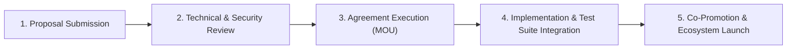

# Formal Partnership Proposal Framework

This document outlines the formal partnership framework for the **Soroban Cookbook**, detailing the mutual value proposition, qualification requirements, formal agreement template (Memorandum of Understanding), and onboarding pathway for ecosystem partners and institutional collaborators.

---

## Table of Contents

1. [Executive Summary](#1-executive-summary)
2. [Benefits & Value Proposition](#2-benefits--value-proposition)
   - [Benefits for Partner Projects](#benefits-for-partner-projects)
   - [Benefits for Soroban Cookbook](#benefits-for-soroban-cookbook)
   - [Benefits for the Stellar & Soroban Ecosystem](#benefits-for-the-stellar--soroban-ecosystem)
3. [Partner Requirements & Eligibility](#3-partner-requirements--eligibility)
   - [Technical Criteria](#technical-criteria)
   - [Open Source & Security Standards](#open-source--security-standards)
   - [Community Engagement & Maintenance Commitments](#community-engagement--maintenance-commitments)
4. [Partnership Tier Structure](#4-partnership-tier-structure)
5. [Formal Partnership Agreement (MOU Template)](#5-formal-partnership-agreement-mou-template)
6. [Partnership Lifecycle & Onboarding Process](#6-partnership-lifecycle--onboarding-process)
7. [Established Partnerships & Current Pipeline](#7-established-partnerships--current-pipeline)

---

## 1. Executive Summary

The **Soroban Cookbook** is the canonical reference architecture and curated patterns library for smart contract development on Stellar's Soroban platform. To bridge reference patterns with real-world enterprise deployments, the Soroban Cookbook establishes formal partnerships with leading Web3 protocols, developer tooling providers, infrastructure operators, and the Stellar Development Foundation (SDF).

Through these formal partnerships, the Cookbook provides verified, production-hardened implementations, while partner projects gain direct distribution, architectural reviews, and developer adoption.

---

## 2. Benefits & Value Proposition

### Benefits for Partner Projects

1. **Ecosystem Visibility & Developer Discovery**:
   - Featured placement in the [Cookbook Showcase](../SHOWCASE.md) and [Featured Projects](./featured-projects.md).
   - Direct backlinks from high-traffic cookbook recipe guides and tutorial sections.
   - Exposure to thousands of smart contract developers building on Stellar.
2. **Authoritative Pattern Validation**:
   - Verification that the partner's SDKs, contracts, or protocols conform to Soroban best practices.
   - Inclusion in continuous automated regression and compatibility test suites.
3. **Co-Marketing & Thought Leadership**:
   - Co-authored developer guides, technical case studies, and architectural deep-dives.
   - Joint hosting opportunities during monthly ecosystem calls and Stellar Wave developer sessions.
   - Social media amplification across community channels and newsletters.
4. **Early Access & Technical Feedback**:
   - Advance insights into emerging Soroban SDK features, protocol upgrades, and tooling releases.
   - Dedicated review channels with Cookbook maintainers for PRs and design proposals.

### Benefits for Soroban Cookbook

1. **Battle-Tested Production Examples**:
   - Real-world production code replaces theoretical or toy implementations.
   - Comprehensive test harnesses reflecting live mainnet traffic and edge cases.
2. **Community Growth & Maintainer Pipeline**:
   - Active contribution of new recipes, vulnerability disclosures, and translations.
   - Cross-pollination of core developers across projects.
3. **Ecosystem Relevance**:
   - Ensures the Cookbook stays aligned with actual production protocol patterns (e.g., AMMs, lending vaults, NFT markets, governance DAOs).

### Benefits for the Stellar & Soroban Ecosystem

1. **Composable Standards**:
   - Encourages uniform interfaces (SEP-41 tokens, Oracle interfaces, Access Control RBAC).
   - Minimizes security regressions caused by bespoke, fragmented code implementations.
2. **Accelerated Developer Onboarding**:
   - New builders can assemble full-stack dApps using modular, partner-verified contract components.

---

## 3. Partner Requirements & Eligibility

To uphold high code quality and user trust, prospective partners must satisfy four core pillars:

### Technical Criteria
- **Soroban SDK Alignment**: Codebase must target the current supported Soroban SDK release and adopt modern conventions (e.g., explicit auth with `require_auth`, structured events, deterministic error codes).
- **Comprehensive Test Coverage**: Minimum 85% test coverage across unit and integration tests, including edge-case simulation and authorization failure validations.
- **Gas & TTL Optimization**: Contracts must implement efficient storage patterns (Instance vs Temporary vs Persistent) and maintain viable TTL renewal strategies.

### Open Source & Security Standards
- **Permissive Open Source Licensing**: Public repositories licensed under MIT, Apache 2.0, or dual MIT/Apache.
- **Independent Security Review**: Documented internal audit checklist or formal third-party audit report.
- **Public Issue Tracking**: Clear security vulnerability disclosure policy (`SECURITY.md`).

### Community Engagement & Maintenance Commitments
- **Designated Technical Liaison**: A primary point of contact responsible for responding to recipe updates and version deprecations.
- **Maintenance SLA**: Commitment to update cookbook integrations within 30 days of major breaking SDK or protocol upgrades.
- **Community Reciprocity**: Inclusion of a reciprocal link or mention in partner documentation / repository README.

---

## 4. Partnership Tier Structure

| Tier | Focus | Key Deliverables | Review Cadence |
|------|-------|------------------|----------------|
| **Tier 1: Strategic Ecosystem Partner** | Foundation & Core Infrastructure (e.g., SDF, Primary RPCs, Wallets) | Joint roadmapping, full protocol integration suite, official co-branding | Monthly sync |
| **Tier 2: Protocol Integration Partner** | Production dApps (DeFi, NFTs, Identity, Bridges) | Dedicated showcase case study, runnable integration tests, joint guide | Quarterly review |
| **Tier 3: Tooling & Community Partner** | Indexers, explorers, client SDKs, testing libraries | Tutorial recipe, README reciprocal badges, developer workshop | Bi-annual review |

---

## 5. Formal Partnership Agreement (MOU Template)

Below is the standard Memorandum of Understanding (MOU) executed between the Soroban Cookbook Maintainers and participating Partner Organizations:

```markdown
# MEMORANDUM OF UNDERSTANDING (MOU)
## COOPERATIVE OPEN SOURCE PARTNERSHIP

This Memorandum of Understanding ("MOU") is entered into as of [DATE] (the "Effective Date"), by and between:

1. **The Soroban Cookbook Project** (represented by its Core Maintainers)
   - Contact: maintainers@sorobancookbook.org
   - Repository: https://github.com/Soroban-Cookbook/Soroban-Cookbook-
2. **[PARTNER ORGANIZATION / PROTOCOL NAME]** ("Partner")
   - Representative: [NAME, TITLE]
   - Contact: [EMAIL]
   - Repository: [URL]

### 1. Purpose and Objective
The purpose of this agreement is to establish a non-exclusive collaborative relationship to advance developer tooling, code quality, and architectural education within the Stellar Soroban smart contract ecosystem.

### 2. Commitments of Soroban Cookbook
- Provide dedicated documentation, case study coverage, and runnable code examples featuring Partner's contracts/tools.
- Include Partner integration tests within the automated Cookbook test and compatibility suite.
- Attribute Partner prominently in the Project Showcase, README, and relevant technical guides.
- Invite Partner to participate in developer workshops and monthly community calls.

### 3. Commitments of Partner
- Maintain and review the shared example implementations to ensure compatibility with current contract versions.
- Designate a technical liaison for developer queries and upgrade notifications.
- Include reciprocal attribution and link to the Soroban Cookbook in Partner's official documentation or developer resources.
- Uphold open-source integrity, reproducible builds, and responsible vulnerability disclosure.

### 4. Intellectual Property & Licensing
All code, documentation, and educational materials produced under this collaboration shall be released as free, open-source software under the Apache 2.0 and/or MIT License. Neither party claims ownership of the other's pre-existing intellectual property.

### 5. Term and Termination
This agreement shall remain effective for a period of twelve (12) months from the Effective Date, automatically renewing annually unless terminated. Either party may terminate this agreement at any time with thirty (30) days written notice without penalty.

### 6. Non-Binding Nature
This MOU signifies mutual intention and goodwill. Except for intellectual property and confidentiality provisions, this document does not create binding financial or legal obligations between the parties.

IN WITNESS WHEREOF, the parties hereto have executed this Memorandum of Understanding as of the date first written above.

For Soroban Cookbook Core Maintainers:
Signature: __________________________   Date: ______________
Name: Shindailulu
Title: Core Maintainer

For Partner Organization:
Signature: __________________________   Date: ______________
Name: [REPRESENTATIVE NAME]
Title: [REPRESENTATIVE TITLE]
```

---

## 6. Partnership Lifecycle & Onboarding Process

The formal onboarding pathway consists of five discrete stages:



1. **Submission**: Prospective partner opens an issue using the `[Partnership Proposal]` template or submits a PR adding their proposal document.
2. **Technical & Security Audit**: Cookbook maintainers review contract architecture, test suite pass rate, and licensing compliance.
3. **MOU Execution**: Core maintainers and partner sign the bilateral open-source partnership agreement.
4. **Integration**: Companion example added under `examples/` or `tests/integration/`, with automated CI regression testing.
5. **Launch**: Joint announcement on community Discord, Stellar developer channels, and update to `SHOWCASE.md`.

---

## 7. Established Partnerships & Current Pipeline

The table below tracks confirmed institutional partners and ongoing collaboration proposals:

| Partner | Category | Tier | Focus Area | Status | Agreement Date |
|---------|----------|------|------------|--------|----------------|
| **Stellar Development Foundation (SDF)** | Ecosystem / Protocol | Tier 1 | Core Soroban SDK standards, developer tutorials, grants alignment | Established | July 2026 |
| **SoroStream** | DeFi / Payments | Tier 2 | Real-time token streaming and escrow authorization | Established | August 2026 |
| **StellarStream** | Payments / Tooling | Tier 2 | Automated recurring transfer streams & deployment guides | Established | August 2026 |
| **Soroban NFT Marketplace** | NFTs / Commerce | Tier 2 | Non-fungible token auctions, royalty standards, escrow | Established | September 2026 |
| **Blend Protocol** | DeFi / Lending | Tier 2 | Lending pool mechanics, oracle valuation, collateral liquidation | Under Review | In Pipeline |
| **Phoenix Hub** | DeFi / AMM | Tier 2 | Concentrated liquidity AMMs and multi-hop routing | Under Review | In Pipeline |

---

## 8. How to Submit a Proposal

To submit a formal partnership proposal:
1. Review the requirements in Section 3.
2. Complete the agreement terms outlined in Section 5.
3. Submit a pull request linking your project or open an issue on GitHub tagged with `enhancement, phase-8, Stellar Wave`.
4. Join the monthly ecosystem developer call to present the integration roadmap.
